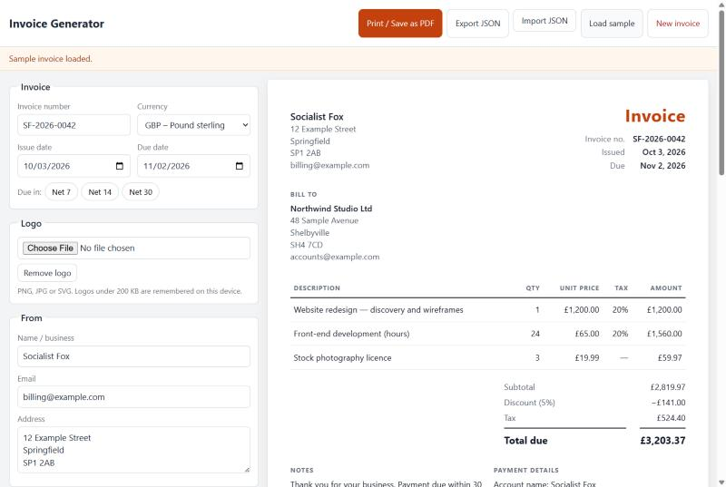

# Invoice Generator

A free, single-page invoice maker for freelancers and small agencies. Fill in the form, watch a clean invoice build itself alongside, and save it as a PDF with your browser's print dialog.

No account, no server, no build step, no tracking. Open `index.html` and start invoicing.



## Why

Most online invoice tools want a sign-up, upload your client data to their servers, or stamp their brand on your PDF. This one is a few static files you can keep on your own machine, read in an afternoon and change however you like.

## Features

- Editable **From** and **Bill to** blocks
- Invoice number with an automatic next-number suggestion (`INV-0041` → `INV-0042`)
- Issue and due dates, with **Net 7 / 14 / 30** quick buttons
- Currencies: USD, GBP, EUR, PKR, INR, AED, AUD, CAD, formatted with `Intl.NumberFormat`
- Line items with description, quantity, unit price and optional per-line tax %; add, remove and reorder
- Invoice-level discount (percentage or fixed amount) and shipping
- Optional logo upload
- Notes / payment terms and bank details
- Live, print-ready preview; prints only the invoice on A4 or Letter
- Export and import invoices as JSON
- Draft autosaved in your browser
- Sample invoice to see it in action
- Responsive down to 375px, keyboard and screen-reader friendly

## How to use

1. Download or clone the repository and open `index.html` in any modern browser (double-click works; no server needed).
2. Fill in your details, your client's details and the line items. The preview updates as you type.
3. Click **Print / Save as PDF**.
4. In the print dialog choose **Save as PDF** (or "Microsoft Print to PDF") as the destination, pick A4 or Letter, and save.

Tip: turn off "Headers and footers" in the print dialog for the cleanest PDF.

Use **Export JSON** to keep a copy of an invoice you can reload later with **Import JSON**. **New invoice** clears the form and suggests the next invoice number.

## How totals are calculated

All money maths lives in [`invoice-math.js`](invoice-math.js) and is covered by tests.

1. **Line amount** = quantity × unit price, rounded to 2 decimals.
2. **Subtotal** = sum of the rounded line amounts.
3. **Discount** is applied **before tax**. A percentage discount is a percentage of the subtotal; a fixed discount is an amount. Either is capped at the subtotal. The discount is shared across lines in proportion to their amounts, so each line is taxed on what the client actually pays for it. Any rounding remainder goes to the last line, so the shares always add up to the discount exactly.
4. **Line tax** = (line amount − its discount share) × tax %, rounded to 2 decimals. **Tax** is the sum of line taxes.
5. **Shipping** is added after tax and is not taxed.
6. **Total** = subtotal − discount + tax + shipping.

Rounding is half away from zero at each step, with a small correction for floating-point values such as `1.005`. Rounding per line (rather than only at the end) means every number printed on the invoice adds up to the total shown.

Empty rows, negative numbers and non-numeric input count as zero rather than producing errors.

## Privacy

Everything stays in your browser. The app makes no network requests. Your draft, last invoice number and logo (if under about 200 KB) are kept in your browser's `localStorage` on this device only. Larger logos are kept for the current session only. Clearing your browser's site data removes them.

## Run the tests

Requires Node.js 21 or later.

```sh
npm test
```

## Project structure

```
index.html            Page markup: editor form and invoice preview
styles.css            Screen and print styles
app.js                Editor, preview rendering, storage, import/export
invoice-math.js       Totals calculation (browser global + Node module)
tests/
  invoice-math.test.js  node:test suite for the totals maths
docs/
  screenshot.png      Screenshot used in this README
```

## License

[MIT](LICENSE) © 2026 Socialist Fox
